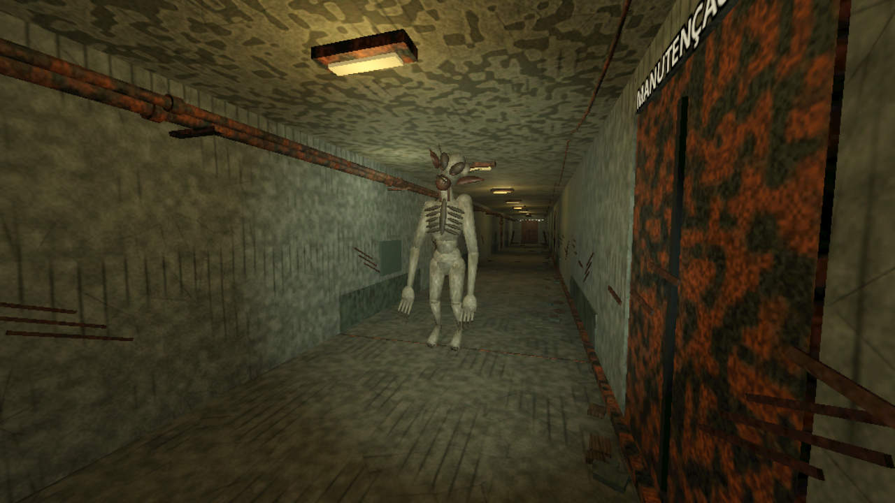

# ECOS — Instalação Abandonada

Protótipo vertical de survival horror 3D em GDScript, desenvolvido com **Godot 4.7.2 stable**. A versão 0.6 acrescenta materiais físicos, objetos manipuláveis e impactos ouvidos pela criatura. A arte e a simulação usam soluções procedurais e simplificadas; desempenho e microfone em Android físico ainda precisam de validação.

**Prévia atual 0.6:** [jogar na web](https://feature-physical-world-mater.run-away-ecos.pages.dev/) · [APK Android r2](https://github.com/luquinhardp-cmyk/Run_away/releases/download/v0.6.0-physics/ecos-android-r2.apk) · [relatório completo](docs/RELATORIO_FISICA_OBJETOS.md). O Firebase cuida de login/progresso; o Cloudflare hospeda o jogo. Após entrar, use **IMPORTAR CHECKPOINT DO VISITANTE** se quiser levar o progresso local de visitante à conta.

Histórico: a [expansão 0.4](docs/RELATORIO_EXPANSAO.md) introduziu percepção/memória/busca modular, distrações, rotas, chave, painel e dificuldades; a [0.5](docs/RELATORIO_TERROR_VISUAL.md) acrescentou criatura redesenhada, placas e terror contextual. A produção 0.3 permanece separada das prévias.

## Executar

1. Importe `project.godot` na Godot 4.7.2 e pressione **F6 na cena main** ou **F5**.
2. Escolha nova sessão e jogar com ou sem microfone. Com microfone, fique em silêncio por três segundos. Use fones.
3. Lanterna na mesa da enfermaria → fusível na manutenção → painel de fusível e gerador na energia → cartão na segurança → saída no extremo do corredor. A galeria lateral liga manutenção e segurança; a chave do depósito abre o atalho da oficina. Colete peças e use Q / ARREMESSAR para distrair.

No workspace entregue, `Jogar.bat` usa a engine portátil em `../.tools/godot`, se presente. É possível informar outro executável na variável `GODOT_EXE`.

| Tecla / gesto | Ação |
|---|---|
| WASD / arrastar lado esquerdo | Mover |
| Mouse / arrastar lado direito | Olhar |
| Shift / CORRER | Correr (botão de toque alterna) |
| C / AGACHAR | Alternar agachamento |
| E / INTERAGIR | Usar, coletar, esconder ou sair |
| F / LANTERNA | Alternar lanterna |
| Tab / MOCHILA | Consultar itens |
| Esc / PAUSA | Pausar |

## Entrega

- `scenes/main/main.tscn`: menu, consentimento, carregamento e término.
- `scenes/levels/facility.tscn`: planta modular construída em tempo de execução e navigation mesh.
- `scenes/player/player.tscn`: CharacterBody3D, câmera, lanterna e interação.
- `scenes/enemy/creature.tscn`: Escutador com mesh/UV/skin, 29 ossos, 12 clipes, nove estados e NavigationAgent3D.
- `scenes/ui/hud.tscn`: joystick, área de olhar, botões e indicadores.
- `scripts/interactions/interactable.gd`: portas, itens, gaveta, documento, gerador, distração, saída e armários.
- Autoloads: Game (estado/saves), Cloud (login/Firestore), NoiseBus (eventos/oclusão), Mic (captura/RMS), Sound (áudio espacial).
- `assets/audio`: 17 WAVs originais, incluindo escuta, passos da criatura, vento e gotejamento. `assets/icon.svg`: ícone original.
- `tests`: testes de integração e captura visual. `docs`: projeto, arquitetura e plano de validação Android.

## Testes

```powershell
godot --headless --path . res://tests/runner.tscn
godot --path . res://tests/visual.tscn
```

A suíte tem 69 verificações e restaura o checkpoint do usuário após a execução. Testes de toque usam eventos sintéticos: não certificam touchscreen físico. Não abra uma sessão de jogo simultânea à suíte, que usa o diretório de dados do mesmo projeto. A captura visual gera `docs/menu.png` e `docs/gameplay.png`.

## Limites desta versão

Microfone e permissões Android exigem validação em aparelho real. Os limiares de áudio são **valores iniciais relativos ao piso calibrado**, não um balanceamento validado. Os perfis gráficos não constituem medição de FPS. O modelo é uma primeira versão artística com anatomia segmentada e animações procedurais; navegação é baked ao carregar, e portas têm animação provisória de painel retrátil. A criatura pode abrir portas; paredes permanecem sólidas. Não há combate ou bateria escassa. Consulte `docs/TESTES_ANDROID.md` antes de considerar a versão pronta para distribuição.

Exportação local não publica em lojas. Veja os presets e as instruções Android na documentação.

## Teste pelo navegador e download

Publicado para testes em [Cloudflare Pages](https://run-away-ecos.pages.dev/) com [download do APK 0.3](https://github.com/luquinhardp-cmyk/Run_away/releases/download/v0.3.0-cloud/ecos-android.apk). Firebase fornece login e progresso por conta; o endereço antigo do Firebase redireciona ao Cloudflare. Abra **CONTA / PROGRESSO** para criar uma conta. [Dados salvos e funcionamento](docs/CONTAS_E_PROGRESSO.md).

O preset Web usa renderer Compatibility e áudio Stream para suportar processamento de captura. Não equivale ao renderer Mobile do APK. A versão Web requer WebGL 2, WebAssembly e HTTPS para o microfone. O APK de teste é distribuído nas Releases do repositório, fora do histórico Git.

## Direção de arte 0.2

- Dez materiais PBR, 60 mapas em 512²/256² e recursos editáveis em `assets/materials`.
- Pátio rural e subsolo conectados à fase, com navegação testada; objetivos originais preservados.
- Escutador: 8.940 triângulos no modelo principal, 4.112 no reduzido, 29 ossos, UVs, quatro materiais e 12 animações.
- Escuta de 1,6 s: para, inclina a cabeça e abre as conchas auditivas antes de investigar. Eventos repetidos não reiniciam o gesto.
- Armários com frestas reais e câmera interna corrigida; menu com cenário 3D original.

[Guia de arte](docs/DIRECAO_ARTE_TERROR.md) · [Criatura](docs/CRIATURA_PRINCIPAL.md) · [Materiais](docs/BIBLIOTECA_MATERIAIS.md) · [Otimização e limites](docs/OTIMIZACAO_GRAFICA_ANDROID.md)

```powershell
godot --path . res://tests/art_review.tscn
```

Esse teste gera dez vistas em `docs/review` e métricas amostrais de renderização. Não constitui benchmark Android.


