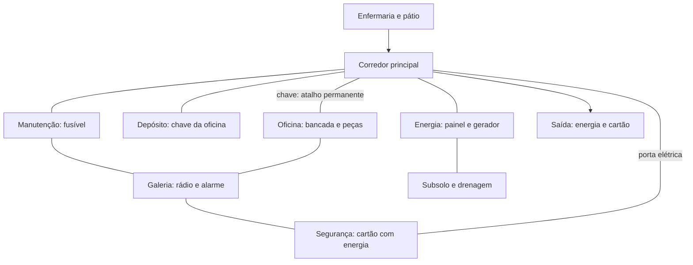

# Mapa interconectado

A planta original de 21 células, pátio e subsolo foi preservada. Sete células acrescentam galeria industrial e oficina: **28 células** ao todo. A galeria em x=12 liga manutenção (z=-8), oficina (z=-16) e segurança (z=-24). O corredor principal é curto e exposto; a galeria é mais longa, oferece rádio, alarme, peças e bancada. O depósito contém a chave que libera o acesso central à oficina. Essa chave é opcional para concluir a fase.

Marcadores e placas dão referências aos caminhos. O cartão permanece indisponível sem energia, mesmo entrando pela galeria. O painel foi afastado de uma caixa que bloqueava a interação durante o teste físico.

Portas fechadas operáveis ficam fora do bake e são abertas fisicamente pela criatura quando necessário. Portas trancadas recebem proxies sólidos invisíveis na geometria de navegação; desbloquear/remove proxy e solicita um bake controlado. Um obstáculo ambiental novo também solicita atualização. Solicitações simultâneas são agrupadas; não há bake por frame. A colisão física e a visão permanecem ativas nas portas reais.

O cano caído ocupa parte do corredor, preservando passagem lateral. Nenhum evento remove o fusível, o cartão ou a única saída. O bake continua síncrono e pode causar um pico de frame em aparelhos fracos; isso deve ser medido antes de ampliar muito a planta.
